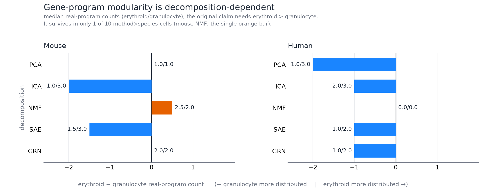
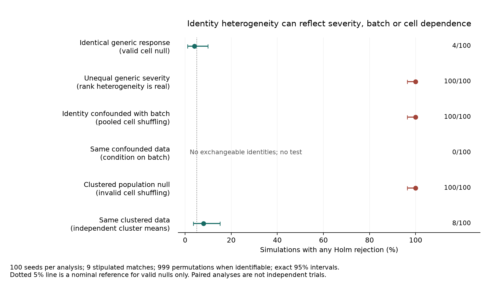
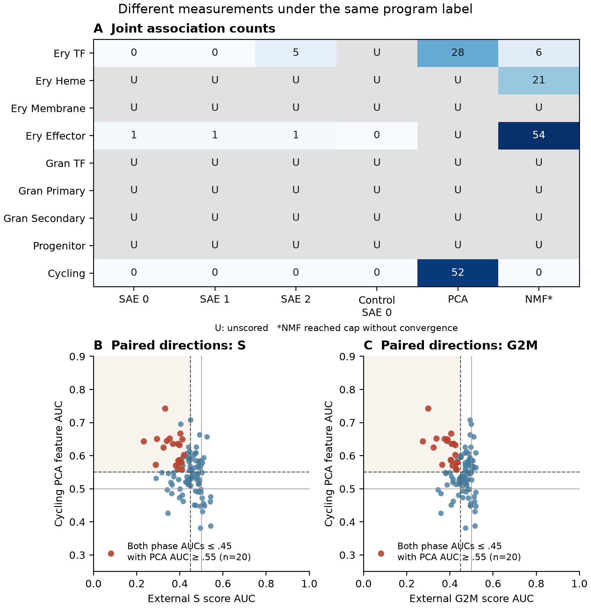
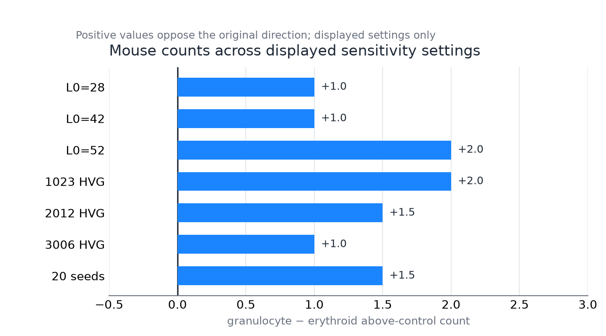

# Representation and annotation change measured structure and perturbation responses of hematopoietic gene programs

**Internal manuscript draft, updated 2026-10-20. Not ready for submission.** Primary numerical
results below come from preserved Gate-0 artifacts and a fresh, archived Norman
external-marker analysis, completed full-size SAE fits and exploratory
historical-program diagnostics. Historical causal analyses lack their original result
JSONs and are excluded from the primary results. The program-modulation design audit uses synthetic data and tests statistical
interpretation, not biological discovery. No novel biological mechanism is claimed.

**Authors and affiliations:** TODO: author-confirmed author list, order, affiliations,
and corresponding-author contact. **Mentorship:** TODO: confirm scientific supervision
and each mentor's role. No mentor approval is implied by this draft.

## Abstract

Biological labels on sparse-autoencoder (SAE) features need not determine a
representation-independent structure or a faithful perturbation readout. We audited
hematopoietic gene programs across structural and perturbation analyses. A
version-locked analysis following exploratory development used mouse Paul15 data
(2,730 cells, 2,012 genes) and human Setty marrow data (4,142 cells, 2,032 genes).
None of ten SAE seeds per dataset supported the hypothesis that erythroid commitment is more distributed than granulocyte
commitment; only mouse NMF supported it among ten method-by-dataset combinations.
Legacy modulation gates accepted identical generic responses in 20/20 simulated
worlds. Conditional identity tests removed that failure but rejected all nine
panels in 100/100 worlds with variable-strength generic effects. Three fresh
200-epoch Norman CRISPRa SAE fits left normal-marrow heme and membrane panels
unmatched. The exact historical eight-gene K562 program instead yielded 63, 61, 61
associations, with 57 direct-score calls and 38 surviving reference, depth and every single gene omission check. Ordinary PCA recovered 65, while one control-only SAE recovered 8.
Program definition and granularity therefore changed recovery; this historically
selected signature does not provide independent confirmation. A 0.88% decrease in
NMF reconstruction error also added a membrane annotation. Twenty Cycling PCA-up
associations had both external phase AUCs≤0.45; verified signed-weight attribution
showed falling phase-gene contributions outweighed by other genes. These results
support conditional program associations and representation/annotation dependence
in the tested systems. They do not establish pathway-specific regulation,
independent biological replication, new regulator mechanisms or an SAE advantage.

## Introduction

Erythroid and granulocyte differentiation involve recognizable transcription factors,
biosynthetic machinery, and terminal effector genes, providing a test of whether
features represent reproducible organization rather than appealing annotations. Single-cell studies have
characterized heterogeneous myeloid progenitors and human differentiation
trajectories [1,2]. A decomposition of those data, however, measures expression
through its own constraints: variance maximization, nonnegative factors, independent
components, or sparse reconstruction.

An SAE expresses observations through a dictionary of learned features with sparse
activity. Matching a feature to familiar genes demonstrates a descriptive
relationship. It does not determine how many biological programs exist, whether
another method would recover the same partition, or which perturbations regulate
the feature. These questions require different controls. The present project began with a directional claim: granulocyte
commitment was treated as unified while erythroid commitment was considered
distributed. Exploratory metric and marker corrections changed its interpretation,
motivating an explicit final decision rule and comparisons across methods.

Related foundation-model work distinguishes model-internal SAE ablations from
cellular causal structure and quantifies annotation-selection and sign-bias
effects in validation [9]. Our expression-space analysis asks different questions;
it does not claim to introduce SAE interpretation or biological causal discovery.

We test that direction across two datasets and five decomposition families, then
audit a perturbation-validation design. The contribution is an inspectable account
of what these measurements support, without claiming that SAE use in single-cell
biology is original or that all biological modules must be representation-invariant.

## Methods

### Evidence set and analysis chronology

The primary evidence set comprises committed preprocessing and training reports,
decision JSONs, per-seed CSVs, baseline summaries, and robustness summaries under
[`data_g0/`](../data_g0/) and [`data_g0_human/`](../data_g0_human/). Analyses were
developed on these biological systems before the final Gate-0 specification was
version-locked. The lock preceded the final runs; it did not precede all exploration.
SHA-256 checks establish preservation of the specified files, not independent
prospective registration or protection against every researcher choice.

Later causal metric amendments followed inspected outcomes. Historical Replogle
Perturb-seq [5] and
CRISPRa records are useful context, but original machine-readable outputs were lost
with ephemeral compute instances. Their numerical claims are consequently excluded
from the primary evidence presented here. Fresh Norman CPU fits and baselines
are separately archived; they do not reconstruct the lost historical experiments.

### Data and preprocessing

Mouse data derive from the Paul et al. myeloid progenitor dataset [1]. The supported
preprocessing applies a source-specific log policy to the depth-adjusted expression
matrix, selects highly variable genes, retains available predefined lineage markers,
and scales genes. The resulting matrix contains 2,730 cells and 2,012 genes. The
human arm uses Setty et al. CD34+ marrow data distributed with Palantir [2]. Counts
are normalized to a library-size target of 10,000, log-transformed, subjected to
marker-aware gene selection, and scaled, producing 4,142 cells and 2,032 genes.
Scanpy tooling [4] supports mouse data access. Assay and cell-selection differences require source-specific preprocessing.

Retained genes and marker coverage are recorded in each
`preprocess_report.json` and `gene_names.csv`. Marker panels contain four erythroid submodules and three
granulocyte submodules, with Progenitor and Cycling panels as comparators. Human
symbols are specified in [`config/human_markers.json`](../config/human_markers.json).
These panels define the operational units tested; they are not a complete census
of all lineage biology.

### Sparse autoencoders and structural comparisons

Gate-0 SAEs use 512 nonnegative ReLU features, a linear decoder, reconstruction
loss with an L1 activity penalty, and ten random seeds per dataset. The recorded
fits used 300 epochs. Mean active-feature counts were approximately 35.8 in mouse
and 32.5 in human, within the target range of 20–50. Feature indices were seed-specific.

PCA, NMF, an absolute-Pearson co-expression regulon representation, and FastICA
provided structural comparisons. PCA and NMF used rank 512; NMF required the
nonnegative part of the scaled matrix. FastICA was reported at its convergent
rank of 50 with three seeds. The co-expression representation used correlations
with panel transcription factors and was deterministic; it was not motif-pruned
SCENIC. PCA copies of one fitted basis are not independent random-seed replicates.
Accordingly, these comparisons interrogate a practical analysis pipeline, including
representation-specific transformations, rather than isolating a single algorithm
under identical rank, input values, and effective capacity.

### Operational program measure and decision

For a marker panel of size K among G retained genes, each feature's enrichment is
the fraction of its absolute decoder loading assigned to those markers, multiplied
by G/K. Panel strength is the mean of the three strongest feature enrichments.
For each seed, nonnegative excess strength is measured relative to the Progenitor
panel. A panel contributes an above-control program count only when excess
exceeds 0.10 and its abundance-matched permutation q-value is below 0.05.

The null draws marker-size-matched genes from 20 bins defined by total absolute
decoder mass, using 1,000 draws and Benjamini–Hochberg adjustment across tested
panels [3]. This matches a loading-mass proxy, not measured transcript abundance
directly. The implementation samples within bins with replacement. Permutation
significance uses strength averaged across seeds; the resulting panel significance
is then shared across seed-specific excess decisions. Seeds therefore describe
algorithmic variability, not independent biological replication.

The original directional claim is supported for a seed only if erythroid has at
least two above-control panels, at least as many as granulocyte, and greater
normalized entropy of excess strength. Dataset-level support requires a 60% seed
majority. The rule is more specific than a comparison of median counts alone.
Implementation and frozen constants are in
[`src/v0b_v3_1_decision.py`](../src/v0b_v3_1_decision.py) and
[`config/preregistration_spec.json`](../config/preregistration_spec.json).

### Robustness and perturbation-validation design

Structural sensitivity analyses varied effect thresholds, significance cutoffs,
sparsity, seed count, and gene-panel size. Marker leave-one-out analyses examined
dependence on an individual marker. These evaluate stability within the tested
design and do not replace additional biological datasets.

The subsequent program-modulation design selects a feature using predefined marker
enrichment among control cells, tests its activation under perturbations, and
compares modulator counts with full-label shuffles and other eligible features.
These diagnostics answer different questions. Full-label shuffling removes the
overall perturbation-versus-control response, while a feature-background ranking
compares responsiveness with other learned features. Neither by itself tests
whether perturbation identities have distinct effects. Selection on controls also
uses control membership; describing it as entirely label-free is inaccurate.

A separate conditional identity test therefore retains controls and permutes
perturbation identities among eligible perturbed cells, optionally within nuisance
strata. A rank-location heterogeneity statistic assesses whether feature activity
differs among identities, with Holm correction across all planned programs.
Feature selection must remain invariant under these conditional permutations.
This test addresses cell-level identity heterogeneity, not pathway specificity,
mechanistic mediation, or replication across biological samples. Unequal generic
response severity can also produce heterogeneity.

The synthetic audit compared four worlds over seeds 0–19, with 500 controls,
20 perturbation identities, 60 cells per identity, and 40 planted features. Five
markers identified the target feature. Four identities shifted that feature in
the specific-response world; all twenty shifted it identically in the generic-response
world. A null world had no shifts. In an absent-marker world, constant markers
matched no feature while the last feature had a generic response. Activations were
supplied directly; no SAE was trained. Each analysis used 99 permutations. The
legacy quantitative gates were shuffle p < 0.05 and feature-background percentile
at least 90; the specification's manual biological-coherence criterion was not
scored. The conditional reanalysis included a marker-match gate and one planned
program, so it does not benchmark multiplicity across many programs. Exact binomial
intervals summarize frequencies over simulation seeds only. Corresponding worlds
share baseline draws within seed; each scenario has twenty independent seeds, not
eighty independent replicates across the four scenarios.

A separate fixed calibration used 200 independent null simulations, nine distinct
planned features with stipulated marker matches, and 999 permutations per simulation.
The generator supplied independent normal features. The outcome was any Holm-adjusted
rejection at familywise alpha 0.05. Five paired uniform-offset checks assessed rank
invariance; they were not additional independent simulations.

A subsequent fixed boundary audit used 100 simulation seeds, nine stipulated
matched features and 999 permutations per identifiable analysis. Group severity
spanning 0–4 multiplied fixed feature coefficients spanning 0.5–1.5, producing a
rank-one matrix of group effects. A batch-confounded world assigned each identity
exclusively to its own offset stratum. A population-null cluster world generated
four independent normal cluster offsets per identity, ten cells per cluster and
cell noise SD 0.15. Independent-cell shuffling was compared with a separate test of
the 40 cluster means, using minimum-two-unit eligibility rather than 20 cells.
Worlds shared some baseline draws; these paired comparisons are not independent
trials. All six analyses and all 600 records were retained without tuning the test.

### Fresh external-marker baseline and sensitivities

A separate real-data analysis used the raw Norman K562 CRISPRa counts [6]. Its plan
was declared before examining these new baseline outcomes, informed by prior
project history; this remains an exploratory continuation rather than independent
prospective confirmation. The prepared dataset contains 111,445 cells, including
11,855 controls, 57,831 single-perturbation cells and 41,759 dual-perturbation cells.
All 105 adequately sampled single-perturbation labels were analyzed, without
requiring that their own target transcript be observed.

Duplicate symbols were summed in raw counts, reducing 33,694 columns to 33,660
unique symbols while preserving exact per-cell library totals. All-gene
normalization to 10,000 and log1p preceded marker subsetting. Within each of eight
technical gemgroups, an outcome-blind split assigned half the controls to score
fitting, yielding 5,926 discovery and 5,929 inference controls. Eligible markers
had nonzero expression in at least ten discovery controls and positive variance.
Scores averaged discovery-control-standardized marker expression with a 0.1
standard-deviation floor, requiring at least three eligible markers.

One-sided, tie-corrected Mann–Whitney U statistics and their null variances were
summed within gemgroups; AUC was weighted by within-group comparison pairs. All
nine programs crossed with 105 perturbations entered a single BH family of 945,
including unscorable p=1 records. Activation required q < 0.05 and AUC ≥ 0.55.
The target transcript was omitted where present, with at least three remaining
markers and a separate same-sized correction family. A controls-fixed identity
omnibus used 999 within-gemgroup permutations and Holm over all nine panels.

Additional sensitivities were declared after primary outcomes and before their
own outcomes. They retained the primary scores and control split. Comparisons
used each of four negative-control construct identities, with joint BH across
all 3,780 program–perturbation–reference hypotheses. Depth matching used
within-gemgroup log-UMI quartiles learned from discovery controls, with BH over
945 comparisons. Original and target-omitted scores were corrected separately.
Depth may be a perturbation mediator, so this sensitivity can overadjust genuine
biology. Per-gemgroup effects are descriptive, not biological replication.

### Direct PCA features

After observing the marker baseline and an explicitly interim epoch-20 SAE
inference check, we fixed a separate exploratory PCA analysis before its outcomes.
The identical normalized 111,445 × 4,081 matrix supplied 64 ordinary principal
components (randomized SVD, three power iterations, seed 0). No SAE was trained.
Both signs of each component entered the annotation search. Discovery controls
alone supplied gene associations and marker matching, with Bonferroni over all
eligible orientations; associations used the same inference controls and the
stratified test, with BH over all 945 hypotheses. Identity inference used 999
within-gemgroup permutations and Holm across all nine panels. All-cell fitting
still saw inference-control expression, so this split is not an independent
representation-training holdout. Neither capacity nor all analysis choices are
matched to the 2,048-feature primary SAE; no superiority test is asserted.

An additional fixed rank 64 NMF fit used the same input and analysis routine, with
NNDSVDa initialization, multiplicative updates, Frobenius loss, tolerance 1e-4 and
a 200-iteration cap. Unlike PCA's signed scores, NMF's nonnegative scores make
negative orientations ineligible under the positive-control-activation rule.
Actual joint-fit cell factors were retained rather than recomputed with a later
transform. The cap was reached with a convergence warning; this is a limited
exploratory comparator, not a converged optimum or a definitive method ranking.

A later bounded sensitivity used the actual capped NMF factors as custom
initialization, with the same rank, solver and tolerance and at most 800 further
iterations. This resets the solver's initial-error stopping reference and is not
bit-identical uninterrupted continuation. The complete seven-fit family, retaining
both NMF versions, used joint BH over 6,615 associations and Holm over 63 identity
tests. Its plan preceded additional optimization and retained every outcome.

### Completed Norman SAE fits and phase diagnostic

Three all-cell TopK SAEs used seeds 0, 1 and 2, 2,048 features, k=32, 200 epochs,
batch size 1,024 and the same 111,445 × 4,081 input. The original program
analysis annotated features using all controls and retained per-panel legacy
association/background diagnostics. Separate conditional identity inference used
999 within-gemgroup permutations; all 27 panel-by-seed hypotheses entered joint
Holm correction. A separately declared exploratory seed trained on only 11,855
controls and encoded every cell; full-data HVG selection was retained. It is a
one-seed training-population sensitivity, not an independent validation sample.
Actual checkpoints, input/activation/model hashes, completed epochs and dimensions
were verified before archiving compact outputs. Original inference differs from
the discovery/inference split of the direct baselines.

A later intervention-label diagnostic retained all 105 direct-name target RNA
comparisons plus four author-recorded alternative transcript labels. All-gene
normalization preceded subsetting; the existing inference controls and stratified
tests were reused. One 109-test BH family included absent p=1 records; calls also
required AUC≥.55. Alternative transcripts were not assumed equivalent genes.
No previous analysis removed labels based on this outcome-informed diagnostic.

After observing PCA/marker score discordance, an exploratory phase diagnostic
fixed the external 43 S and 54 G2M gene lists used in the maintained Scanpy
tutorial, citing Tirosh et al. [10]. The actual list was downloaded from a pinned
Broad Institute workshop commit; the tutorial's canonical ZIP could not be
retrieved, so canonical archive identity was not verified. Discovery controls
supplied eligibility, normalization parameters and scales as for the marker
baseline. All 105 perturbations were tested in both directions for both phases,
jointly corrected with all 945 original PCA hypotheses by Holm (1,365 tests).
Target omission was a separate same-sized family. This outcome-informed diagnostic
measures signature-score direction, not cell-cycle progression or proliferation.

### Common inference and signed-weight attribution

An exploratory harmonization was fixed after all original model/baseline/phase
outcomes, before its own results. Three all-cell SAEs, one control-only SAE,
direct PCA and capped NMF used discovery-only annotation and the same inference
controls and stratified tests. Joint BH covered all 5,670 arm-panel-perturbation
hypotheses; Holm covered all 54 arm-panel identity hypotheses, retaining unmatched
p=1 records. A pre-execution amendment fixed 9,999 identity permutations because
999 cannot resolve a first Holm rejection in 54 tests. PCA fit_transform scores
were reconstructed with exact original settings; all 945 archived AUCs, p-values,
annotations and control IDs had to reproduce within prespecified strict tolerances
before use. NMF used its actual retained joint-fit factors. No SAE/NMF was refit.

A separately declared descriptive diagnostic decomposed component-3 score means
into every input gene's saved weight times its within-gemgroup mean expression
change. Pair-count weights matched the stratified AUC, but the decomposition is of
means, not ranks. The later linear projection was compared with recovered original
scores using fixed fidelity bounds (normalized RMSE≤.01 and maximum AUC difference
≤.005). All 105 perturbations and 4,081 genes were retained; requested external
phase genes were separated from other genes and crossed with weight sign.

### Historical K562 program and robustness

After the original comparisons, an exploratory plan fixed the exact historical
lead: HBZ, ALAS2, HBG1, HBG2, HBA1, SLC25A37, GYPB and BLVRB. This signature
was previously selected from the same Norman data; fixing it before reruns does
not create independent confirmation. The same downstream procedures added one
panel to the original nine across all seven completed learned representations
and direct marker scores. No models were refit or genes added to their fixed
input. All 945 original direct-marker comparisons, parameters and split IDs had
to reproduce before interpretation. Joint BH included all 8,400 association
hypotheses and Holm all 80 identity hypotheses, using 9,999 permutations for the
new tests. The list changes cell context and program granularity together.

A subsequent fixed sensitivity reused the ten-panel direct scores, discovery
parameters and all 105 labels. BH covered all 4,200 control-reference comparisons
and 1,050 depth comparisons, separately for primary and target omission. The
intersection additionally required the eight-arm primary call. It is descriptive
robustness, not a new FDR guarantee. Neither these nominal corrections nor identity
permutations replay the historical signature-selection process. The complete
selection procedure has not been calibrated by these diagnostics.

Individual-transcript and single-marker-omission diagnostics retained all
105 labels and the same eight genes. The original 8,400 comparisons plus
840 individual-transcript and 840 omission comparisons entered nominal BH over
10,080. All omission scores averaged seven genes using frozen discovery weights;
no success threshold for the number of individual gene increases was selected.
A further denominator sensitivity excluded these eight genes from library-size
normalization while retaining weights. It reproduced all 945 original gene/program
comparisons before adding 945 new comparisons to nominal BH over 11,025. Neither
normalization establishes absolute RNA abundance or same-cell coactivation.

### Exploratory dual-construct marker contrasts

A later plan fixed analysis of all 131 observed double perturbations (41,759
cells), retaining the existing marker parameters and discovery/inference split.
All pairs had both sampled single arms. Within gemgroups, the contrast was
mean(AB)−mean(A)−mean(B)+mean(inference controls), weighted by usable dual-cell
counts. Scores were scaled by their discovery-control standard deviations. Each
group required at least two cells per usable stratum and 20 pooled cells, with
at least 80% dual-cell coverage. An independent-cell Welch–Satterthwaite approximation
supplied two-sided p-values and pointwise 95% intervals. Holm covered all 9 × 131
hypotheses; a flag also required absolute contrast ≥ 0.2 SD. A separate same-sized
family omitted both target transcripts, retaining at least three markers.

After primary dual outcomes, an explicitly exploratory sensitivity retained
every pair, marker eligibility and the split, but used linear normalized
expression with its own discovery-control standardization. All original primary
estimates reproduced exactly before the sensitivity ran. Joint Holm correction
covered 2,358 scale-specific hypotheses, separately for primary and target omission.
Same-sign consistency required every correction and effect-floor rule on both
scales and their omission scores. Transformation and standardization both vary;
this does not isolate a pure log-link effect or establish independent validation.

## Results

### The original direction was unsupported in both SAE analyses

The frozen SAE decision supported the original hypothesis in 0/10 mouse seeds
and 0/10 human seeds. Median above-control panel counts were 1.5 erythroid versus
3 granulocyte in mouse, and 1 versus 2 in human. The mouse decision JSON's prose
rounds the erythroid median to 2; the numeric field and per-seed data show 1.5,
which is the value reported here. These results reject support under the defined
rule; they do not prove that erythroid differentiation lacks distributed programs.

### Structural interpretation changed across decomposition pipelines

| Representation | Mouse erythroid/granulocyte | Human erythroid/granulocyte |
|---|---:|---:|
| PCA | 1/1 | 1/3 |
| ICA, rank 50 | 1/3 | 2/3 |
| NMF | 2.5/2 | 0/0 |
| SAE | 1.5/3 | 1/2 |
| Co-expression regulons | 2/2 | 1/2 |

Only mouse NMF satisfied the original dataset-level decision, in eight of ten
seeds. Thus one of ten method-by-dataset combinations supported the claim.
The SAE-associated opposite direction was echoed by ICA but was not universal:
mouse PCA and co-expression counts tied, while human NMF detected neither lineage
above the chosen baseline. The ten comparisons are descriptive, not independent population samples. Their disagreement
demonstrates that this operational answer depends on the representation and its
associated preprocessing and capacity choices.

**Figure 1. Representation dependence of the frozen counting rule.** Bars show
median erythroid minus granulocyte above-control panel counts; labels report
the two counts separately. Only mouse NMF satisfies the original decision.
The figure's term “real program” denotes this operational above-control rule,
not a demonstrated biological partition. Seeds and the ten method-by-dataset
combinations are not independent biological samples. ICA uses rank 50 and
NMF/PCA preprocessing differs, as detailed in Methods.

### Tested sensitivity analyses did not restore the original claim

None of twelve threshold combinations per dataset supported the original direction.
Marker omission changed no verdict among 34 mouse and 36 human omissions. Extending
SAE fits to twenty seeds retained the unsupported decision in both datasets; mouse
granulocyte count remained three in all twenty seeds, while human granulocyte count
remained two. Sparsity sweeps also preserved the decision. Gene-panel sweeps covered
approximately 1,000–3,000 selected genes and did not restore support. At the smallest
human panel, counts tied at one rather than reversing the unsupported hypothesis.

These sweeps have qualifications. Fixed regularization pushed active-feature counts
outside the target quality band at gene-panel extremes. Repeated seeds assess a
fixed sample of cells. Stability of a decision can coexist with an incomplete panel,
a biased metric, or weak biological identifiability.
Displayed mouse settings are summarized in Supplementary Figure 1; the complete
human and mouse outcomes remain in the archived sensitivity artifacts.

A secondary TRRUSTv2 [7] comparison in the human arm found curated erythroid target
enrichment in all ten SAE seeds, with median unadjusted p = 6.44 × 10^-5. This is
a structural association based on a curated database and feature selection rule,
not a perturbation experiment or proof that the identified feature implements a
particular transcription-factor mechanism.

### A generic response passed both legacy quantitative gates

| Synthetic world | Legacy quantitative gates passed | Current conditional identity rejection |
|---|---:|---:|
| Four specific responders | 20/20 | 20/20 |
| Identical response in all twenty identities | 20/20 | 0/20 |
| No response | 0/20 | 0/20 |
| No marker-feature match; last feature responds | 20/20 | 0/20, all unmatched |

The generic-response world had no identity-specific effects by construction, yet
both legacy quantitative gates passed in every seed. Consequently those two gates
are insufficient evidence for identity specificity; this does not evaluate the
unscored manual-coherence gate. The specific-response world detected all four true
responders in every seed, with one additional false-positive modulator in each of
two seeds. In the absent-marker world, historical selection returned index −1 and
silently analyzed the last feature. The current marker gate instead marked all
twenty runs unmatched, preventing that invalid interpretation.

Exact 95% binomial intervals are 0.832–1.000 for 20/20 frequencies and 0–0.168 for
0/20 frequencies. Thus zero observed generic-response rejections does not establish
universal calibration or a precise low error rate. These are simulation-seed
intervals, not biological uncertainty. The retained
[legacy results](../data_program_modulation_audit/legacy_counterexamples_20seeds.json),
[current conditional reanalysis](../data_program_modulation_audit/specificity_reanalysis_20seeds.json),
and [intervals](../data_program_modulation_audit/rates_and_intervals.json)
contain the numerical evidence. The inference failure concerns the interpretation
of a diagnostic, not the validity of an experimentally observed biological program.

The separate nine-program null calibration produced 6/200 familywise rejections
(3.0%; exact 95% interval 1.11–6.42%), without evidence of excess false positives
under that generator. All five paired offset-invariance checks passed. The
[calibration summary](../data_program_modulation_audit/calibration/summary.json)
and its provenance record identify the exact executed sources. This finite
calibration does not validate arbitrary real-data exchangeability, marker matching,
or trained-SAE inference.

### Raw marker responses distinguish self-target signal from broader association

The fresh baseline found seven TF-panel, 37 heme-panel, 25 membrane-panel, six
granulocyte-TF and three progenitor associations among 105 single perturbations.
Cycling had no positive association under the fixed AUC criterion. Erythroid
effector, granulocyte-primary and granulocyte-secondary panels were unscorable
because only two, one and two markers, respectively, met discovery eligibility.
They are not negative biological findings.

Target omission retained six TF-panel, 37 heme, 25 membrane, four granulocyte-TF
and three progenitor associations. Requiring the original association also to
survive depth matching and every control reference retained three, 29, 20, four
and two, respectively. These intersections are descriptive robustness, not
independent validation. All comparisons and references are archived in
[`data_norman_continuation/`](../data_norman_continuation/).

KLF1 illustrates the direct-target trap. Its TF-panel AUC was 0.615, but fell to
0.425 after excluding KLF1 from its own score and no longer met the activation
criterion. Its heme and membrane AUCs were 0.626 and 0.580; those signatures do
not contain KLF1, and both survived the sensitivities. Removing CEBPA or CEBPE
left only two granulocyte-TF markers, so those omission comparisons were
unscorable rather than clean negatives.

The target-transcript diagnostic found 90 RNA increases among all 105 direct-name
comparisons. Three direct symbols were absent and 12 observed transcripts failed
the combined effect/significance rule. Two author-recorded alternatives increased
under labels with absent direct symbols, without proving transcript equivalence
or protein function. BAK1 and BCL2L11 had direct RNA AUCs .793 and .715 despite an
unexplained original-code comment that they did not work; that comment therefore
cannot be interpreted as absent RNA induction. All 109 records are
[retained](NORMAN_TARGET_RNA.md), with single-guide and observed-cell limits.

**Figure 2. Fixed-marker associations and an own-transcript diagnostic.** Panel A
reports counts under the primary and explicit sensitivity rules, retaining
unscorable panels. Panel B follows the existing KLF1 candidate after removing its
own transcript from the TF score; downstream panels are unchanged by that
omission. This candidate illustration is post hoc. Scores, depth adjustment and
reference intersections do not supply independent biological validation.

CBL and PTPN12 retained heme and membrane associations across the sensitivities.
UBASH3B's heme AUC was 0.571 against pooled inference controls, but its lowest
control-reference AUC was 0.548, below the 0.55 floor. The earlier candidate trio
therefore cannot be endorsed without qualification. All six adequately covered
panels, including Cycling, showed conditional identity heterogeneity at the
permutation floor (raw p=0.001, Holm p=0.009). This broad pattern does not establish
erythroid pathway specificity, and no SAE advantage follows from a marker baseline.

### Ordinary PCA recovered different annotated responses

The 64 components explained 35.77% of expression variance. Ery_TF matched the
positive orientation of component 12 (zero-based), with 28 positive associations;
Cycling matched component 3, with 52. Both rejected the identity null (Holm
p=0.009). The other seven panels were unmatched and unscored, not biological
negatives. Ery_Effector's adjusted annotation p=0.0561 failed the fixed threshold.

The TF-matched feature's leading associated genes include globins, mitochondrial
transcripts and LMO2. Its annotation does not make it equivalent to the direct
TF score. Similarly, 52 associations for the Cycling PCA feature coexist with
zero for the direct Cycling marker score because these are different measurements.
These results show that ordinary PCA can recover annotated identity-associated
features; they do not rank its biological fidelity or demonstrate an SAE advantage.
Complete comparisons and failures are archived alongside the marker baseline.

The capped NMF fit matched Ery_TF, Ery_Heme, Ery_Effector and Cycling, with six,
21, 54 and zero upward associations, respectively. Other panels remained unscored.
All four matched panels rejected the identity null (Holm p=.009). Its relative
uncentered Frobenius error was 0.334, which is not comparable to PCA's centered
explained-variance ratio. Nonconvergence, unequal capacity and different marker
eligibility prevent a superiority claim; in particular, effector matching beside
an unscorable direct score is not evidence of better biological recovery.

The bounded warm restart met its numerical tolerance after 380 further iterations
(2,339.6 seconds with four CPU threads). Frobenius error decreased from 3,077.27
to 3,050.08, a 0.88% reduction; relative uncentered error was 0.331. The membrane
panel now matched, and seven-fit joint association counts were TF 10, heme 35,
membrane 27, effector 52 and Cycling 0. Other panels remained unscored. Matched
identity tests had Holm p=.0063 across 63 hypotheses. Numerical stopping therefore
changed annotation coverage despite a small reconstruction-error change, without
establishing a global optimum or biological method ranking. Both complete fits
and all comparisons remain [archived](NORMAN_NMF_CONVERGENCE.md).

The phase diagnostic retained 42/43 S and 54/54 G2M markers. Neither signature
had an upward call; 52 S and 37 G2M decreases passed correction and target omission.
Fifty PCA Cycling-up calls remained after the new joint correction; 19 also had
decreases in both phase scores (28 in S, 21 in G2M). A finer-phase upward response
therefore did not explain the score disagreement under this rule. This is
discordance between projections, not proof of cell-cycle arrest or PCA failure.

### Rank heterogeneity did not identify selective regulation or independent units

In the boundary audit, unequal generic severity made all nine features reject
in 100/100 simulations, despite rank-one group effects. This correctly detects
identity rank heterogeneity but cannot distinguish pathway-selective regulation
from generic strength differences. Identical generic responses yielded 4/100
familywise rejections (exact 95% interval 1.10–9.93%). Ignoring complete identity/batch
confounding yielded 100/100 rejections; conditioning correctly reported no
exchangeable identities and no test in every run.

Under the clustered population null, invalid cell shuffling rejected in 100/100
simulations (interval 96.38–100%), compared with 8/100 for the separate cluster-mean
analysis (3.52–15.16%). The latter interval includes 5% but remains wide; this does
not establish universal calibration or identify experimental units in Norman.
An exchangeability assumption and a biological interpretation require distinct
justification. Full outputs are retained in the
[boundary audit archive](../data_program_modulation_audit/boundary_audit/).

**Figure 3. Severity and exchangeability determine interpretation.** Points show
the proportion of 100 simulation seeds with any Holm rejection across nine
stipulated matched features; error bars are exact 95% binomial intervals.
Conditioned batch confounding is untestable and is shown without an interval.
The nominal 5% reference applies only to valid null worlds. Paired analyses share
draws; the independent-cluster analysis uses different units and eligibility
from the invalid cell shuffle. No model learning or biological replication is
assessed by this experiment.

### Completed SAE seeds did not produce a stable candidate passing the legacy gates

All three 200-epoch fits matched Ery_TF, Ery_Effector and Cycling. Each matched
panel had raw identity p=.001 and joint Holm p=.027 across all 27 hypotheses.
Heme and membrane, along with the remaining four panels, were unmatched in every
seed and therefore unscored. This does not imply absence of their biological
responses, which the direct marker baseline detects.

Legacy candidate counts were 0/0/11 for TF, 1/1/1 for effector and 0/0/0 for
Cycling. KLF1 was the sole repeated candidate, but its effector background
percentiles 63/73/68 all failed the legacy 90th-percentile gate. The seed-2-only
TF list reached percentile 98 without seed agreement. No candidate combined the
background criterion and at-least-two-seed agreement; the background criterion
would not itself establish specificity even if met. The interim epoch-20 heme
annotation was absent at the declared 200-epoch endpoints; no epoch was selected
to rescue it. The control-only seed instead matched heme, effector and Cycling,
with KLF1 its sole heme candidate (background percentile 82). It demonstrates
training-population sensitivity in one seed, without identifying the best model.
All original outcomes, including annotation failures, are
[archived](NORMAN_COMPLETED_MODELS.md). Computational agreement is not independent
biological replication, and these counts do not establish an SAE advantage.

### Shared labels retained different intervention responses under common inference

Every representation matched a Cycling feature under discovery-only annotation.
Only PCA had upward associations: 52, versus zero for all four SAE fits and the
capped NMF fit. Among those 52, 20 had both external phase AUCs≤.45. These are
descriptive effect directions; the separate directional Holm result above uses
a different family. Each matched panel rejected identity heterogeneity at raw
p=.0001, joint Holm p=.0054, which does not establish selective regulation.
KLF1 remained the only association shared across at least two all-cell SAE seeds.
Control-only heme matching failed the new annotation gate (adjusted p=.0990).
All 5,670 records and annotation failures are archived.

**Figure 4. Program labels do not equate the measured responses.** Panel A counts
joint BH association calls (q<.05, AUC≥.55), with U indicating an unscored panel.
Models have unequal rank, and NMF reached its iteration cap without convergence;
counts do not rank biological fidelity. Panels B and C show all 105 paired
Cycling PCA and external phase AUCs. Red points meet PCA AUC≥.55 with both phase
AUCs≤.45 (20 observations), a descriptive rule without a new significance claim.
Cells and model fits share one experiment and are not biological replications.

The saved linear projection approximated recovered PCA scores with normalized
RMSE .000154 and maximum AUC difference .0000378, passing the fixed fidelity gate.
All 428,505 gene contributions reconstructed the 105 projected mean changes
(maximum absolute error 2.22e-16). Thirty-two of 97 external phase genes enter the
PCA input. Their net weighted contribution was negative in all 20 direction-discordant cases, while other positive-weight and other negative-weight gene
classes each contributed positively. The latter increases when its genes decrease.
This post hoc partition summary explains score means without attributing ranks,
phase progression, cellular mechanism or superiority to the result. Across all
105 perturbations, 94 had positive negative-weight sums; this algebra is not unique
to the selected cases. Complete partitions and every gene contribution are retained.

### The historical broad K562 program recovered associations across methods

All eight historical genes were present in the fixed model input and met direct-score eligibility. The new program matched every representation. Under the joint
8,400-test association family, all-cell SAE seeds yielded 63, 61, 61 calls; 60 candidates
appeared in all three and 62 in at least two. Direct scores yielded 57, ordinary
PCA 65, capped/warm NMF 54/52 and one control-only SAE 8. Each historical-program
identity test had Holm p=.008 across all 80 hypotheses. Agreement concerns models
of shared cells and does not constitute biological replication or an SAE advantage.

CBL, UBASH3B and PTPN12 appeared in every all-cell seed, both NMF fits, PCA and
direct scores. Their all-cell SAE AUC ranges were .759–.762, .699–.701 and
.778–.784; direct-score AUCs were .748, .698 and .753. The control-only fit gave
.535, .517 and .538, below the .55 effect floor. One control-only seed cannot
establish general failure of that training approach.

Thirty-nine of 57 direct-score calls survived primary, target omission, depth
matching and all four control references. All three historical candidates and
KLF1 remained; minimum reference AUCs were .679, .616, .683 and .814, respectively.
Their depth-matched AUCs were .750, .701, .753 and .862. These targets are not
signature genes, so their target-omission score is unchanged. Full outcomes and
all references are [archived](NORMAN_K562_CONTEXT.md).

Single-gene omissions retained 46 of 57 primary direct-score calls; 38 also
survived all preceding reference/depth checks. CBL, UBASH3B and PTPN12 met the
RNA-increase criterion for all eight individual genes and every omission score.
Their lowest omission AUCs were .729, .684 and .724. KLF1 passed all omissions
but seven individual transcripts, with GYPB AUC .519 below the .55 effect floor.
Excluding signature genes from the denominator left 57 aggregate calls and moved
KLF1 GYPB only to .521. This particular compositional adjustment does not explain
that threshold result; it does not prove absent GYPB response or absolute
transcriptional differences. All 105 labels and all original/new comparisons
remain archived, including unfavorable outcomes.

This broader list combines biosynthetic and effector genes and contains fetal/
embryonic globins. The analysis therefore cannot isolate cell context from
program granularity or establish recovery of a distinct heme submodule. Its
historical selection and shared observed cells further limit inference. The
positive association recovery is compatible with the original nine-panel match
failures; neither result identifies a new pathway-specific regulator.

### Additive departures depended on the marker panel and score scale

The dual screen retained 25 heme contrasts after the target-omission rule
(17 above additive, 8 below), eight membrane (six above, two below), six granulocyte-TF
(one above, five below), 11 progenitor (eight above, three below), and ten Cycling
(nine above, one below). The TF panel retained none and three low-coverage panels
remained unscored. Target omission leaves heme scores unchanged because its
markers are not the perturbed targets; this is not extra independent evidence.

The joint log/linear sensitivity retained 21 heme (14 above/seven below), six
membrane (four above/two below), six granulocyte-TF (one above/five below), four
progenitor (all above) and six Cycling (five above/one below) contrasts. The
preidentified known-context pair CBL+CNN1 had heme contrasts 0.877 SD on the log
score and 1.995 SD on the linear score (joint corrected p<1e-8 on both), while its
membrane comparison remained unflagged. Norman et al. [6] already reported its
erythroid synergy, so this is contextual recovery in the same data, not new biology.
Full outputs, all failures and every joint p-value are retained in
[the dual-marker archive](../data_norman_continuation/dual_marker/).

These are score-scale additive departures. Nonlinear transformation, library
composition, saturation, state mixtures and construct effects remain explanations;
the independent-cell standard errors do not repair unobserved experimental-unit
dependence. We do not call these validated molecular genetic interactions or
interpret larger standardized effects across scales as stronger biological synergy.

## Discussion

The preserved evidence supports a narrower conclusion than either the original
asymmetry story or its reversal: program counts produced by this metric depend on
the chosen decomposition pipeline. Robustness within an SAE does not establish
invariance across models. Conversely, disagreement does not identify which method
is closest to a true biological organization. Methods can emphasize complementary
levels of a hierarchy, and rank or preprocessing differences can change resolution.
These results support operational dependence, not universal artifact claims or
absence of biological modules.

A diagnostic can measure a real response while answering the wrong question.
Concentration of a generic response in an erythroid-like feature would not establish
a distinct set of erythroid regulators. Conditional
identity heterogeneity is a more targeted question, but still admits differences
in stress severity, guide quality, or cell-state composition. Establishing pathway
specificity requires matched generic-response controls, appropriate gene-expression
baselines, and independent evidence.

Control-associated gene annotations also leave intervention directions unspecified.
The Cycling example persists after downstream control/test procedures are
harmonized, and its signed-weight explanation remains close to the original
randomized-SVD scores. This does not identify a defective algorithm: covariance,
gene coverage and different objectives can produce different valid projections.
It does show why a named latent feature should not be treated as interchangeable
with direct signature activation without checking the measured responses.

Historical causal work in this project cannot settle those questions. All-cell
SAE training included perturbed cells even when earlier text specified control-only
training. Matching/test cross-fitting did not create an independent model-training
holdout. The causal representation ladder also trained an SAE on PCA/NMF inputs;
it did not directly compare SAE features with plain PCA or NMF features. Together
with missing original outputs, these issues prevent the historical experiments
from supporting a publication claim of causal superiority. A matched embedding arm,
held-out validation, and durable evidence capture remain required experiments.

## Limitations and next experiments

There is one biological dataset per species, and human CD34+ selection restricts
the states observed. Predetermined, unequal lineage panel collections constrain the
counting measure. Matching on decoder mass is not a universal biological null, and
shared significance across seeds limits independence. NMF rectification, unequal
ICA rank, and deterministic comparator fits complicate attribution to algorithms
alone. Biological effect sizes and uncertainty across independent samples are not
available from these summaries.

The boundary audit now includes graded generic severity, nine programs and
cluster dependence. Full-size SAE fitting and the exploratory common-inference
comparison are complete. Priority validation needs defensible guide or sample
structure and independent datasets. Norman
construct strings often reflect vector orientation rather than independent
sgRNA reagents; they must not be treated as biological replicates.
Independent dataset replication and primary-literature review are needed before
any potentially interesting modulator can be characterized as new biology. None
of these future outcomes is assumed in this draft.

Known biology also limits novelty: the original Norman abstract explicitly reports
CBL/CNN1 synergy driving erythroid differentiation [6]. Prior work links FLI1 and
UBASH3B in erythroleukemia, using interventions and endpoints different from our
CRISPRa marker-score analysis [8]. Neither source independently validates our
scores. The [targeted literature review](LITERATURE_REVIEW.md) documents what was
read and what remains unchecked, including the original Norman full text and
supplements. We do not characterize PTPN12 or UBASH3B as newly discovered regulators.

The historical K562 program illustrates an additional boundary: changing a
marker definition can recover a broad response missed by narrower panels. It does
not identify a better representation or validate a biological module partition.
Because the signature came from the same dataset, nominal p/q values do not
account for its entire historical selection. Independent perturbation experiments
remain necessary for a new regulator or pathway-specific causal claim.

## Data and code availability

Code and small structural evidence artifacts are available in
[the project repository](https://github.com/jbar1125/SAE-scRNA-seq-Research).
Primary-source data are described in [1,2,6]. Large matrices and checkpoints are
excluded from Git; their preprocessing reports record provenance. The frozen mouse
decision bundle has SHA-256 `172861417a923a83705812a96e5ad1e555055e968323289879447e53beb84396`;
the human bundle has `cc8159c882cf326bca5bbbc7f74d110d4a81338ec0ba07e208eb935bc8f729d3`.
Each bundle concatenates its decision JSON and per-seed CSV. Verification is
documented in [REPRODUCIBILITY.md](REPRODUCIBILITY.md). The synthetic audit retains
its exact executed generator source and source hashes in
[`data_program_modulation_audit/`](../data_program_modulation_audit/). The historical
benchmark implementation is pinned to commit `a08db6d`; the subsequent conditional
reanalysis is identified by its source hash. The initial generator did not record
a working-tree dirty flag, a provenance limitation disclosed in its manifest.

Relevant artifacts are each dataset's `v0b_outputs/v0b_v3_1_decision.json`,
`v0b_outputs/v0b_v3_1_per_seed.csv`, `baselines/baselines_results.json`,
`grn/grn_baseline.json`, `ica/ica_baseline.json`, and the `robustness/` and
`sensitivity/` summaries. The TRRUST result is
[`data_g0_human/trrust/trrust_crossref.json`](../data_g0_human/trrust/trrust_crossref.json).
Historical causal evidence limitations are detailed in
[COMPONENT2_RESULTS.md](COMPONENT2_RESULTS.md).

Fresh Norman baseline and sensitivity JSONs, a 945-row table, data fingerprints,
source hashes and technical-overlap metadata are retained under
[`data_norman_continuation/`](../data_norman_continuation/). Large source files and
resumable SAE weights remain outside Git. Their source fingerprints and preparation
policies are recorded. Three completed all-cell SAE JSON/log pairs, their joint
27-test summary and the one-seed control-only records are archived alongside
complete capped-NMF, dual-marker and external-phase outputs. Full-size fits
finished; durable large-model deposition remains outstanding.

**TODO:** deposit durable run archives with machine-readable outputs, exact code
revisions, environment manifests, and source-data access instructions; add archive
identifiers and a release tag. No archive identifier is invented here.

## Contributions, funding, and disclosures

**TODO, author confirmation required:** record contributions for conception,
software, analysis, validation, writing, and supervision; disclose computational
and writing assistance, including AI assistance where required. Confirm funding,
compute support, conflicts of interest, and acknowledgments. Confirm applicable
public-data ethics and competition or journal disclosure requirements; no ethics
determination, institutional approval, or exemption is asserted in this draft.

**Assistance disclosure, factual draft record:** the continuation used OpenAI
Codex for code changes, computational execution, artifact and targeted literature
checks, and manuscript drafting. Human author review and approval remain pending.
Additional assistance in earlier phases and venue-specific wording require an
author-confirmed account.

## References

Bibliographic fields were checked against Crossref, with retrieval provenance in
[`data_literature_review/`](../data_literature_review/). **TODO before submission:**
complete claim verification against primary texts and supplements. Metadata checks
do not imply that every cited paper was read in full.

1. Paul F, et al. Transcriptional heterogeneity and lineage commitment in myeloid
   progenitors. *Cell*. 2015;163:1663–1677.
   <https://doi.org/10.1016/j.cell.2015.11.013>
2. Setty M, et al. Characterization of cell fate probabilities in single-cell data
   with Palantir. *Nature Biotechnology*. 2019;37:451–460.
   <https://doi.org/10.1038/s41587-019-0068-4>
3. Benjamini Y, Hochberg Y. Controlling the false discovery rate: a practical and
   powerful approach to multiple testing. *Journal of the Royal Statistical
   Society: Series B*. 1995;57:289–300.
   <https://doi.org/10.1111/j.2517-6161.1995.tb02031.x>
4. Wolf FA, Angerer P, Theis FJ. SCANPY: large-scale single-cell gene expression
   data analysis. *Genome Biology*. 2018;19:15.
   <https://doi.org/10.1186/s13059-017-1382-0>
5. Replogle JM, et al. Mapping information-rich genotype-phenotype landscapes with
   genome-scale Perturb-seq. *Cell*. 2022;185:2559–2575.e28.
   <https://doi.org/10.1016/j.cell.2022.05.013>
6. Norman TM, et al. Exploring genetic interaction manifolds constructed from
   rich single-cell phenotypes. *Science*. 2019;365(6455):786–793.
   <https://doi.org/10.1126/science.aax4438>
7. Han H, et al. TRRUST v2: an expanded reference database of human and mouse
   transcriptional regulatory interactions. *Nucleic Acids Research*.
   2018;46(D1):D380–D386. <https://doi.org/10.1093/nar/gkx1013>
8. Wang J, et al. FLI1 induces erythroleukemia through opposing effects on
   UBASH3A and UBASH3B expression. *BMC Cancer*. 2024;24:326.
   <https://doi.org/10.1186/s12885-024-12075-2>
9. Kendiukhov I. Causal circuit tracing reveals distinct computational
   architectures in single-cell foundation models: inhibitory dominance,
   biological coherence, and cross-model convergence. *Bioinformatics*.
   2026;42(7):btag379. <https://doi.org/10.1093/bioinformatics/btag379>
10. Tirosh I, et al. Dissecting the multicellular ecosystem of metastatic melanoma
    by single-cell RNA-seq. *Science*. 2016;352(6282):189–196.
    <https://doi.org/10.1126/science.aad0501>

## Supplementary figure

**Supplementary Figure 1. Displayed mouse robustness settings.** Bars show
granulocyte minus erythroid operational above-control counts for the displayed
sparsity, gene-panel and extended-seed settings. The sign convention is opposite
to Figure 1 and positive values do not support the original direction. Values
are descriptive summaries of fixed cells, not population confidence intervals.
The plot does not display every individual threshold or marker omission.
Quality-band deviations at extreme gene panels remain limitations, and human
outcomes must be read from their separate preserved artifacts.
