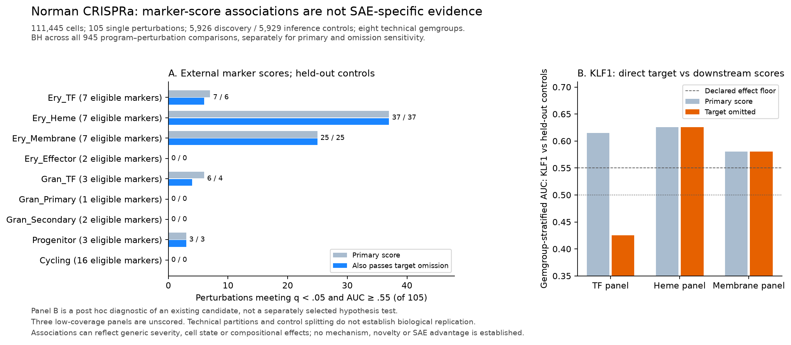

# Norman continuation: fresh archived results

The full-data external-marker baseline and all three full-size 200-epoch SAE
seeds are complete. These are separate analyses. All new
marker results below have machine-readable outputs in
[`data_norman_continuation/`](../data_norman_continuation/), unlike the lost
historical Component 2 outputs. No new biological mechanism or SAE advantage is claimed.

The ordinary PCA baseline and [dual-marker additivity screen](NORMAN_DUAL_MARKER_RESULTS.md)
also completed. The latter retains all 131 observed pairs and explicitly tests
log/linear score sensitivity. These are scale-dependent score contrasts, not
validated molecular genetic interactions. Direct NMF finished its fixed cap with
a convergence warning. The separate one-seed control-only SAE sensitivity also
finished. See [the complete-model interpretation](NORMAN_COMPLETED_MODELS.md)
and [external phase diagnostic](NORMAN_PHASE_DIAGNOSTIC.md).

The [common six-model comparison](NORMAN_SHARED_INFERENCE.md) and
[signed-weight diagnostic](NORMAN_PCA_ATTRIBUTION.md) also completed. All 5,670
association hypotheses and 54 identity hypotheses were retained; every original
PCA/NMF comparison reproduced before new identity inference. All six models
match Cycling, but only PCA has upward associations. For 20 of its 52 calls both
phase AUCs are ≤.45, and signed weights explain how the score mean rises despite
a negative contribution from represented phase genes. This is a score-interpretation
finding in these data, without a new mechanism or method-superiority claim.

## Dataset and design

The raw Norman file was downloaded from the public scverse S3 source, checked at
828,160,302 bytes, and assigned observed SHA-256
`32cc993abad41336eb0f3635f97e802e13fe5721dd9277c1c55e7c13853782e0`.
This is an observed source fingerprint, not an independently supplied checksum.
The existing preparation produced 111,445 cells: 11,855 controls, 57,831 single-
perturbation cells, and 41,759 dual-perturbation cells. All 105 single labels have
enough cells for the marker baseline; the older grounding loader additionally
requires a measured target transcript and therefore calls only 102 testable.

All nine external human marker panels were retained. Every duplicate raw-count
symbol column was summed before normalization: 33,694 columns become 33,660
unique symbols, with exact per-cell count conservation. The 34 duplicate symbols
affect neither the 59 external markers nor the 105 single-target symbols. The
original files remain unchanged. Separate unique-count preparation supplies the
SAE input and retains source Ensembl identifiers.

For the marker baseline, all-gene library normalization to 10,000 and log1p
preceded marker subsetting. Outcome-blind, within-gemgroup control splitting
gave 5,926 discovery and 5,929 inference controls. Discovery controls alone
determined marker detection, means and scales. Three panels had fewer than
three eligible markers and remained unscored.

One-sided stratified Mann–Whitney comparisons used the eight `gemgroup` technical
partitions. All partitions contain controls and every single perturbation.
BH correction covered all 9 × 105 = 945 comparisons, including unscorable p=1
records. A response required q < 0.05 and AUC ≥ 0.55. Removing a perturbation's
own transcript was a separately corrected sensitivity using the same family.
See the [declared plan](../config/marker_program_baseline_plan.json).

## Marker-response results

| Program | Eligible markers | Primary responses | Survive target omission | Also survive depth matching and every control reference |
|---|---:|---:|---:|---:|
| Ery_TF | 7 | 7 | 6 | 3 |
| Ery_Heme | 7 | 37 | 37 | 29 |
| Ery_Membrane | 7 | 25 | 25 | 20 |
| Ery_Effector | 2 | Unscored | Unscored | Unscored |
| Gran_TF | 3 | 6 | 4 | 4 |
| Gran_Primary | 1 | Unscored | Unscored | Unscored |
| Gran_Secondary | 2 | Unscored | Unscored | Unscored |
| Progenitor | 3 | 3 | 3 | 2 |
| Cycling | 16 | 0 | 0 | 0 |

The final column is exploratory. Its plan was written after the primary results,
before sensitivity outcomes. Scores, marker eligibility and the original split
remained fixed. Depth matching used discovery-control UMI quartiles within each
gemgroup; because RNA depth can be downstream of perturbation, this can overadjust
real biology. Control-reference tests used each of four observed negative-control
construct identities, with BH over all 3,780 program × perturbation × reference
comparisons. Intersections are descriptive robustness, not independent replication.
The primary computations were reproduced exactly before running sensitivities.

The full results, all references and descriptive per-partition effects are
archived; no favorable reference or technical partition was selected. See the
[sensitivity plan](../config/marker_baseline_sensitivity_plan.json) and
[945-row comparison table](../data_norman_continuation/marker_baseline/comparisons.csv).

## A direct-target trap and a reference-dependent candidate

KLF1 overexpression has TF-panel AUC 0.615, but the target-omitted TF score has
AUC 0.425 and does not pass the activation criterion. Its heme-panel AUC is 0.626
and membrane-panel AUC 0.580; those panels do not contain KLF1, and both associations
survive all specified sensitivities. Thus a transcript's presence in its own
annotation panel and a downstream marker response must be distinguished.

CEBPA and CEBPE also pass the primary Gran_TF panel, but removing their target
leaves only two eligible markers, below the three-marker rule. Their omission
analyses are **unscorable**, not evidence of absent downstream effects.

CBL and PTPN12 retain heme and membrane associations in all sensitivities. UBASH3B
passes the pooled heme comparison (AUC 0.571) and depth sensitivity, but its lowest
control-reference AUC is 0.548, below the fixed 0.55 effect floor. It therefore
does not belong in the all-reference robust set. This limits the previous
three-candidate narrative rather than confirming it wholesale.

Panel B is a post hoc diagnostic of an existing candidate. Both plots render the
archived outputs; they are not independent validation experiments.

## Conditional identity test and interpretation

All six adequately covered panels, including Cycling, reject the within-gemgroup
identity-shuffle null at the minimum raw p of 0.001 and Holm p 0.009 over nine
planned panels. Cycling nevertheless has no positive response under the
one-sided activation/effect-floor rule. Identity variation and activation are
different questions; neither finding establishes erythroid pathway specificity.
Three low-power panels retain p=1.

These are conditional cell-level associations in one cell line. Technical
partitions are not biological replicates. The observed `guide_identity` strings
often differ only by vector orientation, and CBL has a single observed construct
identity; do not call these independent sgRNA replications. Generic perturbation
severity, compositional normalization, cell state, viability, construct effects
and unobserved confounding remain possible. Literature novelty, independent
experimental validation and an SAE advantage have not been established.

## Ordinary PCA comparison

A [separate exploratory plan](../config/norman_direct_pca_plan.json) fixed 64
ordinary PCA components before outcomes. It used the identical 111,445 × 4,081 input,
randomized SVD with three power iterations and seed 0. No SAE was trained. Both
component signs entered the 128-orientation annotation search and its correction.
The components explained 35.77% of expression variance.

Annotation used the existing 5,926 discovery controls; stratified association tests
used the same 5,929 inference controls as the marker baseline. These controls are
held out from annotation, conditional on the fitted scores. The all-cell PCA fit
still saw their expression: this is not an independent model-training holdout.
BH covered every 9 × 105 comparison, with unmatched hypotheses at p=1.

Ery_TF matched component 12 (zero-based; 28 positive associations), and Cycling
matched component 3 (52). Both had identity Holm p=.009. The other seven panels,
including heme and membrane, did not pass the annotation gate; these are unscored
panels, not zero biological effects. Ery_Effector's adjusted match p=0.0561 also
failed the fixed 0.05 gate and was retained as a failure.

Names do not make different scores equivalent. The TF-matched component's top
associated genes include globins and mitochondrial transcripts as well as LMO2.
The Cycling PCA feature had 52 positive associations, while the direct marker
score had none under its rule. These are different measurements, not a contradiction
or a method ranking. CBL and PTPN12 associate with the Cycling PCA feature, with
AUC 0.570 and 0.609, respectively; this alone does not identify a mechanism.

All 945 comparisons, failures, source/model hashes and split identities are archived
in [`direct_pca/`](../data_norman_continuation/direct_pca/). The fitted PCA weights
remain outside Git. Rank-64 PCA and 2,048 SAE features have unequal capacities, and
the primary SAE's annotation/association procedures differ. No SAE advantage,
PCA superiority, independent replication or new biological mechanism follows
from comparing these counts. The capped NMF analysis is reported below.

## Capped direct NMF comparison

The [separate NMF plan](../config/norman_direct_nmf_plan.json) fixed 64 components,
NNDSVDa initialization, multiplicative updates, Frobenius loss, tolerance 1e-4 and
maximum 200 iterations before outcomes. On the identical input it reached that cap
without satisfying the convergence tolerance. Actual fit time was 1,800 seconds
with one CPU thread while the primary trainer was active. Relative Frobenius
reconstruction error was 0.334; this uncentered quantity is not the PCA explained-
variance ratio and should not be compared as if it were.

Its completed capped-fit analysis matched Ery_TF (six associations), Ery_Heme (21),
Ery_Effector (54) and Cycling (zero positive associations). All four reject the
conditional identity null (Holm p=.009); the other five panels remain unscored.
NMF scores are nonnegative, so the negative orientations of the reused analysis
have no positive control cells and are ineligible. Complete 945-row results and
the warning are archived in [`direct_nmf/`](../data_norman_continuation/direct_nmf/).
Actual joint-fit cell factors and gene components are saved outside Git, and
their hashes, shapes and nonnegativity were verified.

This is an unconverged, capped exploratory fit. It cannot establish a definitive
method comparison. The effector annotation also uses marker presence rather than
the direct score's minimum-detection rule; 54 associations beside an unscorable
direct panel do not establish an NMF advantage. Score definitions, capacities
and annotation search sizes differ. No method superiority or biological novelty
is inferred. Continued NMF optimization would be a separate convergence sensitivity
with its original result preserved.

## Completed full-size SAE fits

The user selected CPU execution. Seeds 0, 1 and 2 all completed 200 epochs on
111,445 cells, with 4,081 selected/force-kept genes, 2,048 latent features, k=32
and batch=1,024. Actual checkpoint/activation hashes and completed training
dimensions were verified. Each seed matched TF, effector and Cycling, with
identity Holm p=.027 across the complete 27-test family. All other panels remain
unmatched. The sole repeated legacy candidate is effector-associated KLF1, whose
background percentiles 63/73/68 all fail the old 90th-percentile gate. No candidate
combines that gate with two-seed agreement. This is not a positive discovery.

The one control-only seed also completed: heme, effector and Cycling matched;
only heme had a legacy candidate, KLF1 (background percentile 82). This is a
single-seed training-population sensitivity. Complete outcomes, limits and
the declared six-model common-inference follow-up are in
[NORMAN_COMPLETED_MODELS.md](NORMAN_COMPLETED_MODELS.md). Run/resume commands
remain [documented](NORMAN_CPU_RUNS.md); do not duplicate finished fits.

### Interim inference readiness check

The [declared diagnostic](../config/norman_interim_diagnostics_plan.json) used a
separate copy of the epoch-20 checkpoint from the 200-epoch parent fit. Inference
and the complete nine-panel analysis finished on all 111,445 cells without further
optimizer steps. This is a partial-model implementation check, not a completed
primary seed, a selected best epoch, or an independent replicate.

Four panels matched an eligible SAE feature: Ery_TF, Ery_Heme, Ery_Effector and
Cycling. Each rejected the conditional identity null (per-seed Holm p=.009);
the other five hypotheses retained p=1. The heme feature had seven exploratory
modulators and a descriptive feature-background percentile of 86. None of the
matched features reached the old 90th-percentile background threshold, which is
itself descriptive and does not establish specificity. Full outputs, negatives
and checkpoint provenance are retained in
[`sae_interim_epoch20/`](../data_norman_continuation/sae_interim_epoch20/).

Annotation coverage differs between analyses: the direct marker baseline requires
detection in at least ten discovery controls, while SAE matching checks marker
presence. HBB was detected in only three discovery controls. An Ery_Effector SAE
match alongside an unscorable direct score therefore does not establish an SAE
advantage. The fixed 200-epoch primary fits remain unchanged.
